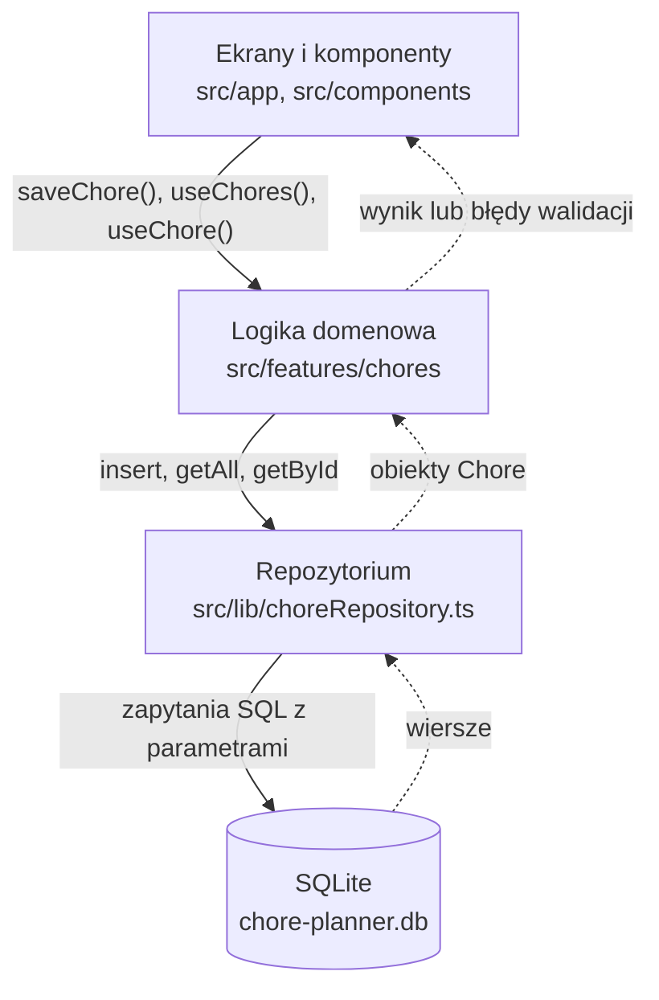
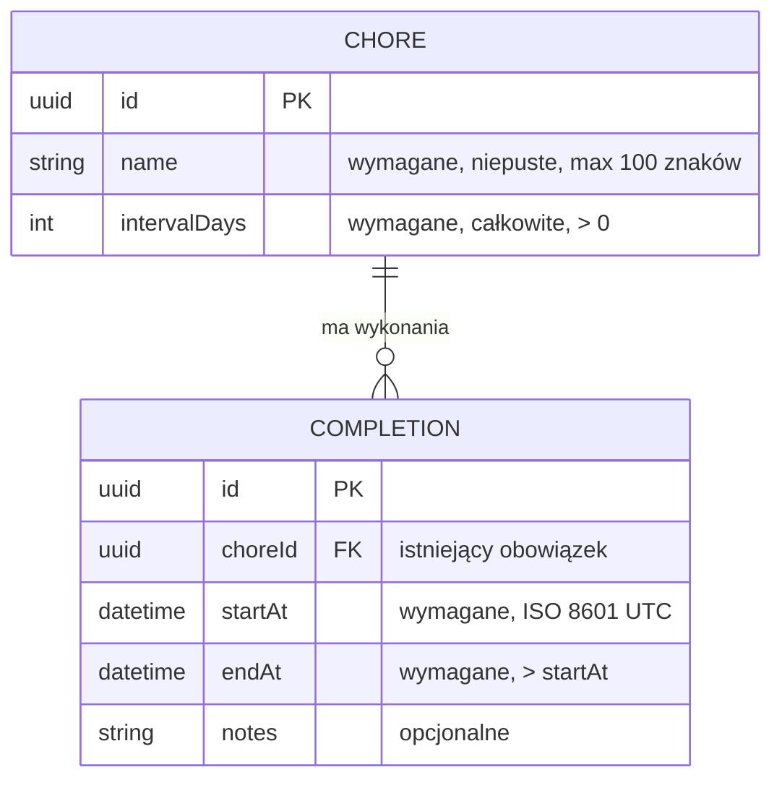
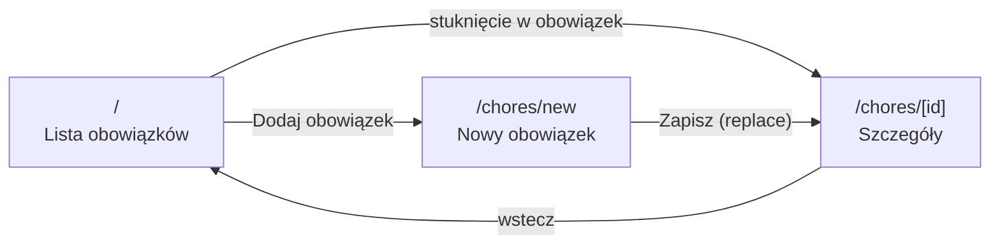

# Architektura: MOB-027 ChorePlanner

Stan na laboratorium 2: dodawanie, lista i szczegóły obowiązków. Wykonania istnieją w modelu danych i w bazie, ich obsługa w UI powstanie w laboratorium 3.

## 1. Struktura projektu

```text
src/
├── app/                      ekrany i routing (Expo Router, routing oparty na plikach)
│   ├── _layout.tsx           stos nawigacji, podłączenie bazy (SQLiteProvider)
│   ├── index.tsx             lista obowiązków
│   └── chores/
│       ├── new.tsx           formularz dodawania obowiązku
│       └── [id].tsx          szczegóły obowiązku
├── components/               komponenty UI wielokrotnego użytku
│   ├── ChoreListItem.tsx
│   ├── PrimaryButton.tsx
│   ├── StateMessage.tsx      pusta lista, błąd, brak rekordu
│   ├── TextField.tsx         pole formularza z etykietą i błędem
│   └── theme.ts              kolory, odstępy, rozmiary tekstu
├── features/chores/          logika domenowa obowiązków, bez UI
│   ├── types.ts              typ Chore
│   ├── validation.ts         walidacja danych formularza
│   ├── saveChore.ts          przypadek użycia: walidacja, UUID, zapis
│   ├── useChores.ts          hooki odczytu: lista i jeden rekord
│   └── format.ts             formatowanie interwału
└── lib/                      dostęp do danych
    ├── db.ts                 nazwa bazy, migracja schematu
    ├── choreRepository.ts    operacje SQL na tabeli chores
    └── useFocusQuery.ts      odczyt z bazy przy wejściu na ekran
```

## 2. Warstwy i kierunek zależności



| Warstwa | Odpowiedzialność | Czego nie robi |
| --- | --- | --- |
| UI (`src/app`, `src/components`) | Wyświetla dane i stany (wczytywanie, pusta lista, błąd), zbiera dane od użytkownika, nawiguje | Nie sprawdza reguł biznesowych, nie wykonuje SQL |
| Logika (`src/features/chores`) | Walidacja, nadanie UUID, decyzja o zapisie, zamiana błędu technicznego na komunikat | Nie zna wyglądu ekranu ani składni SQL |
| Dostęp do danych (`src/lib`) | Schemat bazy, migracje, zapytania, mapowanie kolumn `snake_case` na pola `camelCase` | Nie waliduje danych biznesowych |

Ekrany nie importują repozytorium bezpośrednio do zapisu. Dzięki temu walidację (`validateChoreInput`) można testować jako zwykłą funkcję, bez emulatora i bez bazy (testy automatyczne w laboratorium 4).

## 3. Model danych



| Encja | Pole | Typ w kodzie | Kolumna SQLite | Wymagane | Znaczenie |
| --- | --- | --- | --- | --- | --- |
| Chore | `id` | `string` (UUID) | `id TEXT PRIMARY KEY` | Tak | Lokalny identyfikator z `randomUUID()` |
| Chore | `name` | `string` | `name TEXT` | Tak | Nazwa obowiązku, np. „Odkurzanie” |
| Chore | `intervalDays` | `number` | `interval_days INTEGER` | Tak | Co ile dni powtarzać obowiązek |
| Completion | `id` | `string` (UUID) | `id TEXT PRIMARY KEY` | Tak | Lokalny identyfikator |
| Completion | `choreId` | `string` (UUID) | `chore_id TEXT` | Tak | Klucz obcy do `chores.id` |
| Completion | `startAt` | `string` (ISO UTC) | `start_at TEXT` | Tak | Początek wykonania |
| Completion | `endAt` | `string` (ISO UTC) | `end_at TEXT` | Tak | Koniec wykonania |
| Completion | `notes` | `string \| undefined` | `notes TEXT` | Nie | Uwagi |

**Relacja:** Chore (1) do (N) Completion.

**Spójność danych** jest pilnowana na dwóch poziomach:

1. Logika aplikacji sprawdza dane przed zapisem i zwraca czytelny komunikat dla użytkownika.
2. Baza odrzuca dane, które ominęłyby logikę:
   - `CHECK (length(trim(name)) > 0)`: nazwa niepusta;
   - `CHECK (typeof(interval_days) = 'integer' AND interval_days > 0)`: interwał całkowity i dodatni;
   - `REFERENCES chores (id) ON DELETE RESTRICT`: wykonanie musi wskazywać istniejący obowiązek, a obowiązku z wykonaniami nie da się usunąć (BR-04);
   - `CHECK (end_at > start_at)`: koniec wykonania po początku.

Klucze obce SQLite są domyślnie wyłączone i działają dla jednego połączenia, dlatego `PRAGMA foreign_keys = ON` jest wykonywane przy każdym otwarciu bazy.

**Odstępstwo od karty MOB-027.** Karta definiuje wykonanie z polem `data: date`. W projekcie wykonanie ma `startAt` i `endAt` z godziną, żeby egzekwować regułę, że wykonania nie mogą się nakładać w czasie (przedziały półotwarte `[startAt, endAt)`). Do zgłoszenia prowadzącemu.

## 4. Przechowywanie danych

- Biblioteka `expo-sqlite`: jeden plik bazy `chore-planner.db` w katalogu aplikacji. Dane zostają po zamknięciu i ponownym uruchomieniu aplikacji.
- `SQLiteProvider` w `_layout.tsx` otwiera bazę i przed wyświetleniem ekranów wywołuje `migrateDbIfNeeded`.
- Wersja schematu jest zapisana w `PRAGMA user_version`. Migracja tworzy tabele tylko dla wersji 0; kolejne zmiany schematu dostaną kolejne numery wersji.
- Daty są zapisywane jako tekst ISO 8601 w UTC (np. `2026-11-18T07:00:00.000Z`). W tym formacie porównanie tekstów odpowiada porównaniu czasu, więc baza może sortować i sprawdzać kolejność dat. W UI daty będą pokazywane w czasie lokalnym.
- Wartości trafiają do zapytań wyłącznie przez parametry `?`, nie przez sklejanie tekstu (ochrona przed SQL injection).

## 5. Nawigacja

Expo Router, jeden stos ekranów. Trasy wynikają z plików w `src/app`.



- Do szczegółów przekazywany jest tylko `id`; ekran sam odczytuje rekord z bazy, więc nie pokaże nieaktualnej kopii danych.
- Po zapisie formularz jest zastępowany ekranem szczegółów (`router.replace`). Przycisk „wstecz” prowadzi wtedy do listy, a nie do wypełnionego formularza.

## 6. Zarządzanie stanem i przepływ danych

Bez biblioteki globalnego stanu. Rodzaje stanu:

| Rodzaj | Gdzie | Przykład |
| --- | --- | --- |
| Stan formularza | `useState` w `chores/new.tsx` | wpisana nazwa, błędy pól, trwający zapis |
| Stan odczytu | `useFocusQuery` | `loading`, `ready` z danymi, `error` |
| Dane trwałe | SQLite | rekordy obowiązków |

Jedynym źródłem prawdy jest baza. `useFocusQuery` pobiera dane przy każdym wejściu na ekran (`useFocusEffect`), więc lista po powrocie z formularza pokazuje nowy rekord bez przekazywania danych między ekranami.

## 7. Obsługa błędów

| Sytuacja | Zachowanie |
| --- | --- |
| Błędne dane w formularzu | Komunikat pod polem, czerwona ramka; zapis nie jest wykonywany |
| Błąd zapisu w bazie | Komunikat nad przyciskiem, wpisane dane zostają, szczegóły techniczne w konsoli |
| Błąd odczytu listy lub szczegółów | Komunikat i przycisk „Spróbuj ponownie” |
| Pusta lista | „Nie masz jeszcze żadnych obowiązków.” i przycisk „Dodaj obowiązek” |
| Nieistniejący rekord | „Nie znaleziono obowiązku.” i przycisk „Wróć do listy” |

## 8. Decyzje projektowe

| Decyzja | Wybrane rozwiązanie | Alternatywa | Uzasadnienie |
| --- | --- | --- | --- |
| Zarządzanie stanem | Hooki React + odczyt z bazy przy fokusie ekranu | Zustand, React Context | Jeden użytkownik i kilka ekranów; baza jako jedyne źródło prawdy eliminuje synchronizację kopii danych; brak dodatkowej zależności |
| Przechowywanie danych | `expo-sqlite` | AsyncStorage (klucz-wartość) | Relacja 1:N z kluczem obcym, warunki `CHECK`, zapytania z sortowaniem i filtrowaniem potrzebne w lab 3; moduł Expo SDK działa w Expo Go |
| Nawigacja | Expo Router (stos) | React Navigation konfigurowane ręcznie | Część szablonu Expo, trasy wynikają z plików, parametry trasy (`[id]`) bez dodatkowej konfiguracji |
| Separacja logiki od UI | Warstwy: `app` / `features` / `lib` | Logika i SQL w komponentach ekranów | Reguły testowalne bez UI, jedna implementacja reguły dla wielu ekranów, możliwa wymiana źródła danych |
| Identyfikatory | `randomUUID()` z `expo-crypto` | Własny generator na `Math.random()`, autoinkrementacja SQLite | Karta wymaga lokalnych UUID; kryptograficzny generator systemu |
| Format dat | Tekst ISO 8601 w UTC | Liczba milisekund (epoch) | Czytelny podgląd bazy, poprawne porównania tekstowe, odporność na zmianę czasu |

**Ograniczenia decyzji:**

- Odczyt przy każdym wejściu na ekran wykonuje zapytanie nawet wtedy, gdy dane się nie zmieniły. Dla kilkudziesięciu rekordów jednego użytkownika koszt jest pomijalny; przy dużych zbiorach potrzebne byłoby buforowanie.
- Brak biblioteki UI: komponenty są pisane od zera, co wymaga samodzielnego pilnowania dostępności i spójności wyglądu (`theme.ts`).
- Porównywanie dat jako tekstu działa tylko wtedy, gdy wszystkie daty mają identyczny format; zapis dat musi przechodzić przez jedną funkcję formatującą.
