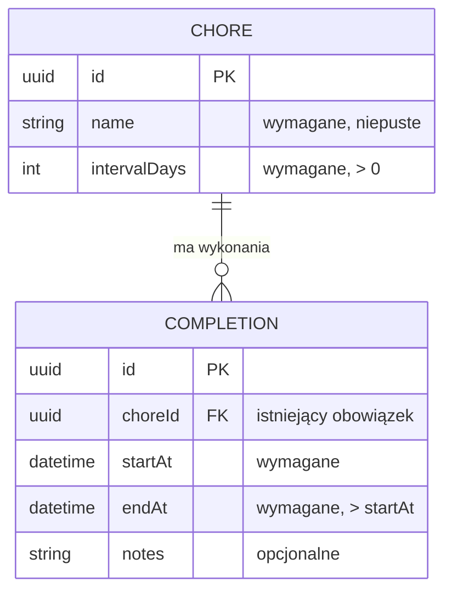

# Laboratorium 2 — sprawozdanie teoretyczne

**Imię i nazwisko:**  Tomasz Sawoszczuk
**Grupa:**  41_Inf_FD_ST_7
**Data:**  05.11.2026

## Zasady opracowania

1. Odpowiedz samodzielnie, korzystając z materiałów udostępnionych na Moodle oraz dodatkowych źródeł technicznych (np. oficjalnej dokumentacji).
2. Nie ograniczaj odpowiedzi do definicji. Wyjaśniaj własnymi słowami, uzasadniaj wnioski i podawaj przykłady.
3. W zadaniach odnoszących się do projektu użyj **własnego, przydzielonego tematu aplikacji**.
4. Podaj źródła wykorzystane do opracowania odpowiedzi. Sam link bez wskazania, do czego został wykorzystany, nie wystarcza.

Projekt: **MOB-027 ChorePlanner**, aplikacja do ewidencji obowiązków domowych i ich wykonań. React Native + Expo SDK 58, Expo Router, lokalna baza `expo-sqlite`, stan oparty na hookach React.

## T1. Podejścia do tworzenia aplikacji mobilnych

**Polecenie:** Zbadaj cztery podejścia: natywne, wieloplatformowe, hybrydowe (WebView) i PWA.

**A.** Uzupełnij tabelę. Zwróć uwagę, że „wieloplatformowe” i „hybrydowe” nie muszą oznaczać tego samego.

| Kryterium                    | Natywne | Wieloplatformowe | Hybrydowe (WebView) | PWA |
| ---------------------------- | ------- | ---------------- | ------------------- | --- |
| Sposób tworzenia interfejsu  | Narzędzia i komponenty systemu: Jetpack Compose na Androidzie, SwiftUI na iOS | Wspólny kod; React Native mapuje komponenty na natywne widoki, Flutter rysuje widgety własnym silnikiem | Strona HTML/CSS/JS wyświetlana w komponencie WebView wewnątrz natywnego kontenera | Strona HTML/CSS/JS uruchamiana w przeglądarce, z manifestem i service workerem |
| Dostęp do funkcji urządzenia | Pełny i bezpośredni, od razu po wydaniu nowej wersji systemu | Przez moduły i biblioteki, w razie braku przez własny moduł natywny | Przez mosty i wtyczki, np. Capacitor | Tylko przez API przeglądarki; zakres zależy od przeglądarki i systemu |
| Dystrybucja aplikacji        | Sklepy | Sklepy, jak aplikacja natywna | Sklepy, aplikacja jest zapakowana w natywny kontener | Adres URL i instalacja z przeglądarki; na Google Play opcjonalnie przez Trusted Web Activity |
| Typowe ograniczenie          | Dwie osobne bazy kodu i dwie technologie do utrzymania | Część zachowań różni się między systemami i wymaga kodu zależnego od platformy; zależność od zgodności wersji bibliotek | Interfejs to strona internetowa, więc gorzej wypada przy długich listach i animacjach; każda funkcja natywna wymaga wtyczki | Różne wsparcie API w przeglądarkach (np. Safari wymaga niestandardowych zgód dla czujników); nie spełnia wymagań projektu (musi to być aplikacja mobilna) |
| Przykładowa technologia      | Kotlin + Jetpack Compose, Swift + SwiftUI | React Native (Expo), Flutter, NativeScript | Ionic + Capacitor, Apache Cordova | Aplikacja webowa z service workerem (np. React + Vite) |

**B.** Wybierz dwa podejścia do aplikacji wymagającej działania bez internetu i dostępu do aparatu. Porównaj je, wskazując założenia i ryzyka.

**Odpowiedź:**

Porównuję podejście wieloplatformowe i PWA.

| | React Native + Expo | PWA |
| --- | --- | --- |
| Założenia | Dane w lokalnej bazie, aparat przez `expo-camera`; oba moduły są w Expo SDK 58 i działają w Expo Go | Pliki aplikacji w cache service workera, dane w IndexedDB, aparat przez `getUserMedia` w przeglądarce |
| Offline | Aplikacja jest zainstalowana w całości, więc działa bez sieci od pierwszego uruchomienia | Działa offline dopiero po pierwszej wizycie online, gdy service worker zapisze zasoby w cache |
| Aparat | Natywny dostęp z podglądem, zdjęciami i skanowaniem kodów; zgoda systemowa | Zależy od przeglądarki; zachowanie na iOS i Androidzie może się różnić |
| Ryzyka | Niezgodne wersje bibliotek między SDK; biblioteki spoza Expo SDK wymagają development builda | System lub przeglądarka może usunąć dane strony przy braku miejsca; użytkownik może nie wiedzieć, jak zainstalować PWA; ograniczenia Safari |

Dla aplikacji, która musi działać offline i robić zdjęcia, wybrałbym React Native. PWA nie ma takiej trwałości danych

Service worker to skrypt działający w tle przeglądarki, który przechwytuje zapytania sieciowe i może odpowiadać z cache. Dzięki niemu PWA otwiera się bez internetu, ale tylko jeśli wcześniej zapisał potrzebne pliki. Aplikacja React Native ma wszystkie pliki w zainstalowanym pakiecie, więc tego problemu nie ma. W ChorePlannerze nie używam aparatu, ale działanie offline jest podstawą, bo wszystkie dane są lokalne.

**C.** Wskaż źródła, na podstawie których dokonałeś porównania.

**Źródła:**

- materiały do laboratorium 2: opis czterech podejść i uwaga, że wieloplatformowe nie oznacza WebView
- React Native, „Core Components and Native Components”: mapowanie komponentów na widoki Androida i iOS
- Android Developers, Jetpack Compose: przykład podejścia natywnego
- Ionic, „Fundamentals”: WebView jako kontener aplikacji hybrydowej, dostęp do aparatu i GPS przez Capacitor/Cordova
- Capacitor, dokumentacja: natywny runtime dla aplikacji webowych z wtyczkami
- MDN, „Progressive web apps”: definicja PWA, service worker, praca offline
- web.dev, „Learn PWA: Capabilities”: różnice w obsłudze API między przeglądarkami, ograniczenia Safari, Trusted Web Activity
- Expo, `expo-sqlite` (SDK 58), Expo, `expo-camera` (SDK 58): moduły dla wariantu React Native
- Flutter, Impeller: własne renderowanie interfejsu

## T2. Architektura i podział odpowiedzialności

**Polecenie:** Wyjaśnij, dlaczego oddzielenie interfejsu, logiki aplikacji i dostępu do danych jest przydatne w projekcie CRUD.

**A.** Opisz własnymi słowami odpowiedzialność trzech wymienionych obszarów. Podaj po jednym przykładzie operacji, która powinna należeć do każdego z nich.

**Odpowiedź:**

| Obszar | Odpowiedzialność | Przykład z ChorePlannera | Miejsce w projekcie (plan) |
| --- | --- | --- | --- |
| Interfejs | Wyświetla dane, zbiera działania użytkownika i pokazuje komunikaty. Nie decyduje, czy dane są poprawne biznesowo. | Ekran formularza wykonania pokazuje pola dat i komunikat „Wykonanie nakłada się na inne” zwrócony przez logikę. | `src/app/`, `src/components/` |
| Logika aplikacji | Pilnuje reguł biznesowych i decyduje, co zrobić po akcji użytkownika. Nie wie, jak wygląda ekran ani jak dane są zapisane. | Funkcja sprawdzająca, czy nowe wykonanie nie nakłada się na istniejące, i funkcja wyliczająca następny termin. | `src/features/chores/`, `src/features/completions/` |
| Dostęp do danych | Udostępnia operacje typu „zapisz”, „pobierz listę”, „usuń” i ukrywa, że pod spodem jest SQL. | `completionRepository.insert(completion)`, które wykonuje `INSERT` w SQLite. | `src/lib/` |

Każda warstwa ma jeden powód do zmiany. Gdy zmienię wygląd listy, ruszam tylko UI. Gdy prowadzący zmieni regułę nakładania się wykonań, zmieniam tylko funkcję w `features/completions`. Gdybym kiedyś zamienił SQLite na inną bazę, zmieni się tylko repozytorium, a ekrany i reguły zostaną bez zmian.

**B.** Rozważ sytuację: ekran formularza bezpośrednio zapisuje dane do bazy, sprawdza reguły biznesowe i wyświetla komunikaty. Zidentyfikuj **dwa konkretne problemy** takiego rozwiązania i zaproponuj zmianę.

**Odpowiedź:**

1. **Reguł nie da się przetestować bez uruchamiania ekranu.** Sprawdzenie siedziałoby w komponencie, więc test musiałby renderować formularz i mieć bazę. Karta wymaga testu pozytywnego i negatywnego reguły, a requirements chcą testów w CI, gdzie nie ma emulatora.
2. **Ta sama reguła byłaby w kilku miejscach.** Wykonanie dodaję z formularza i edytuję z ekranu szczegółów. Jeśli każdy ekran sam pisze SQL i sam sprawdza nakładanie się, łatwo poprawić regułę w jednym miejscu i zapomnieć o drugim (np. przy edycji nie pominąć edytowanego rekordu).

**Zmiana:** formularz tylko zbiera dane i wywołuje jedną funkcję logiki, np. `saveCompletion(dane)`. Ta funkcja waliduje i woła repozytorium. Wynik wraca do formularza, który tylko go wyświetla.

Czysta funkcja to taka, która dla tych samych danych zawsze zwraca ten sam wynik i niczego nie zapisuje. Funkcja „czy przedział 8:30-9:00 nakłada się na 8:00-8:45” jest czysta, więc test to jedna linijka bez telefonu i bez bazy. Zapis do bazy zostaje w repozytorium, które w testach można zastąpić prostą atrapą.

**C.** Naszkicuj przepływ danych podczas dodawania rekordu w Twojej aplikacji (diagram Mermaid albo opis kolejnych kroków). Nazwij odpowiedzialne komponenty.

**Diagram / opis:**

**Plan**

```mermaid
sequenceDiagram
    actor U as Użytkownik
    participant F as CompletionForm (UI, src/app)
    participant L as saveCompletion (logika, src/features/completions)
    participant R as completionRepository (src/lib)
    participant DB as SQLite (expo-sqlite)
    participant Lst as Lista wykonań (UI)

    U->>F: wybiera obowiązek, start, koniec, uwagi; „Zapisz”
    F->>F: sprawdza format pól (stan lokalny formularza)
    F->>L: saveCompletion(dane)
    L->>R: czy obowiązek istnieje?
    L->>R: wykonania w przedziale [startAt, endAt)
    R->>DB: SELECT
    DB-->>R: wiersze
    R-->>L: wykonania
    L->>L: endAt > startAt, brak nakładania
    alt dane poprawne
        L->>R: insert(wykonanie z nowym UUID)
        R->>DB: INSERT (klucz obcy choreId)
        L-->>F: sukces
        F->>Lst: powrót do listy
        Lst->>R: ponowny odczyt przy fokusie ekranu (useFocusEffect)
        R-->>Lst: aktualna lista z nowym wykonaniem
    else błąd walidacji lub zapisu
        L-->>F: lista błędów
        F-->>U: komunikat przy polu, wpisane dane zostają
    end
```

Kroki do przetestowania bez emulatora: walidacja w `saveCompletion` i wyliczenie terminu, bo to zwykłe funkcje TypeScript. Repozytorium da się podmienić atrapą. Emulator jest potrzebny tylko do sprawdzenia samego ekranu i prawdziwego zapisu w SQLite.

`useFocusEffect` z Expo Router uruchamia kod za każdym razem, gdy ekran staje się aktywny, także po powrocie z innego ekranu. Dzięki temu lista po powrocie z formularza sama pobiera dane z bazy i nie muszę przekazywać nowego rekordu między ekranami.

## T3. Model danych i reguły biznesowe

**Polecenie:** Zaprojektuj model danych na podstawie **własnych wymagań biznesowych**.

**A.** Wskaż co najmniej dwie encje, ich atrybuty (z typami danych) oraz relację. Zaznacz identyfikatory i pola wymagane.

| Encja | Atrybut | Typ | Wymagane? | Uzasadnienie |
| ----- | ------- | --- | --------- | ------------ |
| Chore (obowiązek) | `id` (PK) | UUID | Tak | Lokalny identyfikator, wymagany przez kartę dla każdej encji |
| Chore | `name` | string | Tak | Nazwa obowiązku, np. „Odkurzanie”; po niej działa wyszukiwanie; nie może być pusta |
| Chore | `intervalDays` | int | Tak | Co ile dni powtarzać obowiązek; liczba całkowita > 0; potrzebna do wyliczenia terminu |
| Completion (wykonanie) | `id` (PK) | UUID | Tak | Lokalny identyfikator |
| Completion | `choreId` (FK) | UUID | Tak | Wskazuje istniejący obowiązek |
| Completion | `startAt` | datetime | Tak | Początek wykonania; najpóźniejszy `startAt` jest podstawą terminu |
| Completion | `endAt` | datetime | Tak | Koniec wykonania; musi być późniejszy niż `startAt`, potrzebny do sprawdzania nakładania się |
| Completion | `notes` | string? | Nie | Dowolne uwagi, np. „zabrakło worków” |

Relacja: Chore (1) do (N) Completion. Jeden obowiązek ma wiele wykonań, każde wykonanie należy do dokładnie jednego obowiązku.

**Odstępstwo od karty:** karta podaje dla wykonania jedno pole `data: date`. Zamieniam je na `startAt` i `endAt` z godziną, żeby móc sprawdzać, czy wykonania się nie nakładają.

**B.** Przedstaw diagram relacji encji (np. Mermaid `erDiagram`) albo własny czytelny schemat.

**Diagram:**



`||--o{` oznacza: obowiązek może mieć zero lub wiele wykonań, wykonanie ma dokładnie jeden obowiązek.

**C.** Opisz **dwie reguły biznesowe** specyficzne dla Twojego projektu. Dla każdej podaj przypadek poprawny i niepoprawny.

**Odpowiedź:**

**Reguła 1: wykonania nie mogą się nakładać w czasie.** Dotyczy całej aplikacji, niezależnie od obowiązku, bo jedna osoba nie robi dwóch rzeczy naraz. Przedziały są półotwarte `[startAt, endAt)`, czyli koniec jednego wykonania może być początkiem następnego. Przy edycji pomijam edytowany rekord.

- Poprawny: istnieje „Odkurzanie” 8:00-8:45. Dodaję „Zmywanie” 8:45-9:15. Zapis przechodzi.
- Niepoprawny: przy tym samym „Odkurzaniu” dodaję „Zmywanie” 8:30-9:00. Zapis zablokowany: „To wykonanie nakłada się na: Odkurzanie (8:00-8:45)”.
- Niepoprawny: koniec 8:00, początek 8:30 (`endAt <= startAt`). Zapis zablokowany.

**Reguła 2: nie można usunąć obowiązku, który ma wykonania.** Usunięcie zostawiłoby wykonania wskazujące na nieistniejący obowiązek.

- Poprawny: „Mycie okien” nie ma wykonań. Po potwierdzeniu obowiązek znika z listy.
- Niepoprawny: „Odkurzanie” ma 3 wykonania. Usunięcie zablokowane: „Nie można usunąć obowiązku, bo ma 3 wykonania. Usuń najpierw wykonania.”

_Wytłumaczenie:_
Przedział półotwarty `[8:00, 8:45)` zawiera 8:00, ale nie zawiera 8:45. Dwa przedziały A i B nakładają się, gdy `A.startAt < B.endAt` i `B.startAt < A.endAt`; dla 8:00-8:45 i 8:45-9:15 drugi warunek daje `8:45 < 8:45`, czyli fałsz. Blokadę usuwania sprawdzam w logice (czytelny komunikat), a klucz obcy w SQLite jest drugim zabezpieczeniem. Dokumentacja `expo-sqlite` podaje, że klucze obce trzeba włączyć poleceniem `PRAGMA foreign_keys = ON` i że nie działa ono wewnątrz transakcji.

## T4. Nawigacja i zarządzanie stanem

**Polecenie:** Zaplanuj sposób przechodzenia między ekranami oraz przepływ informacji w aplikacji.

**A.** Zidentyfikuj co najmniej trzy ekrany własnej aplikacji. Dla każdego określ jego cel, dane wejściowe i możliwe akcje użytkownika.
    

| Ekran | Cel | Dane wejściowe | Akcje użytkownika |
| ----- | --- | -------------- | ----------------- |
| Lista obowiązków | Przegląd obowiązków i terminów, „co trzeba zrobić” | Wszystkie obowiązki z bazy + najpóźniejsze wykonanie każdego (do wyliczenia terminu) | Wyszukaj po nazwie, sortuj po nazwie lub terminie (rosnąco/malejąco), otwórz szczegóły, dodaj obowiązek |
| Szczegóły obowiązku | Dane jednego obowiązku i historia jego wykonań | `id` obowiązku z parametru trasy; obowiązek i jego wykonania z bazy | Edytuj obowiązek, usuń (z potwierdzeniem, blokada przy istniejących wykonaniach), dodaj wykonanie, otwórz wykonanie |
| Lista wykonań | Przegląd wszystkich wykonań w aplikacji | Wszystkie wykonania z nazwami obowiązków | Filtr po obowiązku i dacie, sortowanie po dacie, otwórz szczegóły wykonania |
| Szczegóły wykonania | Pełne dane jednego wykonania | `id` wykonania z parametru trasy | Edytuj, usuń z potwierdzeniem |
| Formularz wykonania (dodawanie/edycja) | Utworzenie lub zmiana wykonania | Przy edycji: `id` wykonania; przy dodawaniu z ekranu obowiązku: `choreId`; lista obowiązków do wyboru | Wybierz obowiązek, ustaw start i koniec, wpisz uwagi, zapisz, anuluj |
| Formularz obowiązku (dodawanie/edycja) | Utworzenie lub zmiana obowiązku | Przy edycji: `id` obowiązku | Wpisz nazwę i interwał, zapisz, anuluj |

Przejścia: Lista obowiązków > Szczegóły obowiązku > Formularz wykonania lub Formularz obowiązku; Lista wykonań > Szczegóły wykonania > Formularz wykonania. Dwie listy jako zakładki na dole ekranu, reszta w stosie (Expo Router).

**B.** Wyjaśnij różnicę między stanem lokalnym formularza a danymi utrwalonymi. Opisz, co powinno się wydarzyć po zapisaniu nowego rekordu i powrocie do listy.

**Odpowiedź:**

Stan lokalny formularza to wartości wpisywane przez użytkownika (`useState` w komponencie formularza): niezapisana nazwa, wybrane godziny, komunikaty błędów walidacji. Istnieje tylko, dopóki ekran jest otwarty, i nikt poza formularzem go nie widzi. Dane utrwalone to wiersze w SQLite: przetrwają zamknięcie aplikacji i są wspólne dla wszystkich ekranów.

Po naciśnięciu „Zapisz”:
1. Logika waliduje dane i repozytorium zapisuje rekord w bazie.
2. Dopiero po potwierdzeniu zapisu formularz się zamyka i wraca do listy. Stan formularza znika razem z ekranem.
3. Lista przy powrocie (`useFocusEffect`) pobiera dane z bazy na nowo, więc pokazuje nowe wykonanie i przeliczony termin obowiązku.
4. Użytkownik dostaje krótką informację „Zapisano”.

_Wytłumaczenie:_
Materiały do laboratorium dzielą stan na trzy rodzaje: chwilowy stan UI (np. otwarte okno potwierdzenia usunięcia), stan aplikacyjny (np. wpisana fraza wyszukiwania i wybrany filtr na liście) i dane trwałe (rekordy w bazie). W ChorePlannerze jedynym źródłem prawdy dla danych jest baza, a stan w komponentach to tylko kopia do wyświetlenia albo niezapisane zmiany.

**C.** Wskaż jeden problem wynikający z niespójności stanu między ekranami i zaproponuj sposób jego uniknięcia.

**Odpowiedź:**

Problem: lista obowiązków pobiera dane raz przy pierwszym otwarciu i trzyma je w `useState`. Użytkownik wchodzi w „Odkurzanie”, dodaje wykonanie i wraca. Lista nadal pokazuje stary termin „Do wykonania”, bo jej kopia danych nie wie o zmianie w bazie. Ten sam błąd wystąpi, gdy ekran szczegółów dostanie przez nawigację cały obiekt wykonania, a nie jego `id`: po edycji pokaże stare wartości.

Rozwiązanie:
- przez parametry trasy przekazuję tylko `id`, a ekran sam odczytuje rekord z bazy (`useLocalSearchParams` + repozytorium);
- każdy ekran listy i szczegółów odświeża dane przy fokusie (`useFocusEffect`), więc po powrocie zawsze widzi aktualny stan bazy;
- termin następnego wykonania wyliczam przy odczycie, zamiast zapisywać go w bazie, więc nie może się rozjechać z wykonaniami.

_Wytłumaczenie:_
Niespójność powstaje, gdy dwie kopie tych samych danych zmieniają się niezależnie. Przy małej aplikacji z jednym użytkownikiem najprostsze jest odczytanie danych z bazy przy każdym wejściu na ekran, zamiast synchronizowania wielu kopii. Biblioteka globalnego stanu (np. Zustand) byłaby tu dodatkową warstwą bez wyraźnego zysku (wymagania projektu: „nie należy sztucznie rozbudowywać architektury”).

## T5. Trwałość danych, walidacja i błędy

**Polecenie:** Zbadaj konsekwencje wyboru mechanizmu przechowywania danych i zaplanuj obsługę sytuacji niepoprawnych.

**A.** Porównaj przechowywanie danych wyłącznie w pamięci aplikacji z lokalną trwałą bazą danych. Kiedy dane zostaną utracone? Które podejście spełnia wymagania Twojego projektu?

**Odpowiedź:**

| | Pamięć aplikacji (tablica w stanie) | Lokalna baza SQLite (`expo-sqlite`) |
| --- | --- | --- |
| Gdzie są dane | W pamięci RAM procesu aplikacji | W pliku bazy w katalogu aplikacji na telefonie |
| Kiedy dane giną | Przy zamknięciu aplikacji, zabiciu jej przez system w tle, awarii, restarcie telefonu, a w czasie pracy nawet przy przeładowaniu kodu | Dopiero przy odinstalowaniu aplikacji lub wyczyszczeniu jej danych w ustawieniach |
| Relacje i spójność | Trzeba pilnować w całości w kodzie | Klucz obcy `choreId` i zapytania SQL pomagają pilnować, żeby wykonanie zawsze wskazywało istniejący obowiązek |
| Wyszukiwanie, filtry, sortowanie | Filtrowanie tablic w JS | `WHERE`, `LIKE`, `ORDER BY` w zapytaniu |

Wymagania projektu spełnia tylko baza trwała. Karta wymaga zachowania danych po ponownym uruchomieniu (kryterium akceptacji 5), a requirements wprost mówią, że CRUD oparty wyłącznie na pamięci nie wystarcza. Dokumentacja potwierdza, że baza `expo-sqlite` zostaje zachowana między uruchomieniami aplikacji.

_Wytłumaczenie:_
Android może w każdej chwili zamknąć aplikację działającą w tle, żeby odzyskać pamięć. Użytkownik tego nie widzi, ale po powrocie aplikacja startuje od zera. W ChorePlannerze oznaczałoby to utratę całej historii wykonań, a bez niej nie da się wyliczyć terminu.

**B.** Wskaż trzy przypadki walidacji wynikające z wymagań Twojej aplikacji. Dla każdego określ warunek oraz komunikat dla użytkownika.

| Pole / operacja | Warunek poprawności | Przykład błędnych danych | Komunikat |
| --------------- | ------------------- | ------------------------ | --------- |
| Nazwa obowiązku | Niepusta po usunięciu spacji z początku i końca | `""`, `"   "` | „Podaj nazwę obowiązku.” |
| Interwał w dniach | Liczba całkowita większa od 0 | `0`, `-3`, `2,5`, `abc` | „Interwał musi być liczbą całkowitą większą od 0.” |
| Start i koniec wykonania | `endAt > startAt` | start 9:00, koniec 8:30 | „Koniec musi być później niż początek.” |
| Nakładanie się wykonań | Brak innego wykonania z przedziałem przecinającym `[startAt, endAt)` | nowe 8:30-9:00 przy istniejącym 8:00-8:45 | „To wykonanie nakłada się na: Odkurzanie (8:00-8:45).” |
| Obowiązek wykonania | Wybrany obowiązek istnieje w bazie | brak wyboru lub obowiązek usunięty w międzyczasie | „Wybierz obowiązek z listy.” |

**C.** Opisz zachowanie aplikacji w dwóch sytuacjach: (1) lista nie zawiera rekordów; (2) zapis danych kończy się błędem. Wyjaśnij, co użytkownik powinien zobaczyć i dlaczego.

**Odpowiedź:**

**(1) Pusta lista.** Zamiast pustego ekranu: tekst „Nie masz jeszcze żadnych obowiązków” i przycisk „Dodaj obowiązek”. Osobno obsługuję sytuację, gdy rekordy są, ale wyszukiwanie lub filtr nic nie zwraca: „Brak wyników dla »odk«” i przycisk „Wyczyść filtry”. Pusty ekran bez opisu wygląda jak błąd albo trwające ładowanie, a komunikat mówi użytkownikowi, co się stało i co może zrobić dalej.

**(2) Błąd zapisu.** Formularz zostaje otwarty z wpisanymi danymi, nad przyciskiem pojawia się komunikat „Nie udało się zapisać wykonania. Spróbuj ponownie.”, a przycisk „Zapisz” znów jest aktywny. Aplikacja nie wraca do listy i nie pokazuje „Zapisano”. Szczegóły techniczne (treść błędu SQLite) trafiają do logów, nie do użytkownika. Dzięki temu użytkownik nie traci wpisanych danych, nie myśli, że zapis się udał, i nie widzi niezrozumiałego komunikatu bazy.

_Wytłumaczenie:_
Każde wywołanie repozytorium zwraca sukces albo błąd, a logika zamienia błąd techniczny na komunikat dla użytkownika. Przykład: jeśli obowiązek zostanie usunięty, gdy formularz wykonania jest otwarty, SQLite odrzuci zapis z powodu klucza obcego, a użytkownik zobaczy „Wybrany obowiązek już nie istnieje”, zamiast „FOREIGN KEY constraint failed”.

## Wnioski końcowe

1. Która decyzja architektoniczna w Twoim projekcie jest obecnie najważniejsza i dlaczego?
2. Jaką kwestię musisz jeszcze zweryfikować przed dalszą implementacją?

**Wnioski:**

1. Najważniejsza jest dla mnie decyzja, że reguły biznesowe trzymam w osobnych funkcjach w `src/features/`, a jedynym źródłem danych jest baza SQLite. Reguła o nienakładaniu się wykonań wymaga porównania nowego wykonania ze wszystkimi wykonaniami w aplikacji, więc nie mogę jej sprawdzać na danych, które akurat ma w pamięci jeden ekran. Do tego karta wymaga testów reguł, a wydzielone funkcje mogę testować bez emulatora. Odświeżanie list przy powrocie na ekran zamiast globalnego store'a utrzymuje architekturę na poziomie potrzebnym dla aplikacji jednego użytkownika.
2. Przed implementacją muszę ustalić sposób zapisu dat w bazie: czy `startAt` i `endAt` trzymam jako tekst ISO w UTC, czy w czasie lokalnym. Od tego zależy poprawność sprawdzania nakładania się i wyliczania terminu, np. przy zmianie czasu na zimowy. Muszę też zgłosić prowadzącemu zamianę pola `data` z karty na `startAt` i `endAt` oraz sprawdzić w praktyce, czy włączenie kluczy obcych (`PRAGMA foreign_keys = ON`) przy otwieraniu bazy rzeczywiście blokuje zapis wykonania bez obowiązku.

Ocena uwzględnia poprawność merytoryczną, kompletność, uzasadnienie decyzji, odniesienie do własnego projektu oraz jakość dokumentacji. Samo przepisanie definicji bez analizy nie jest wystarczające.
