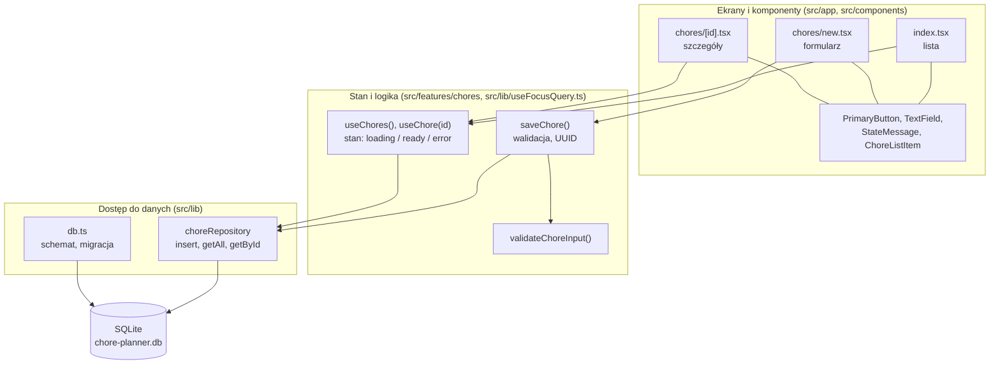
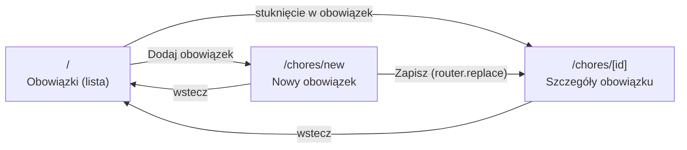

# Sprawozdanie — Laboratorium 2

**Przedmiot:** Budowa aplikacji mobilnych z użyciem technologii frontendowych  
**Student / identyfikator:** 149905  
**Projekt biznesowy:** MOB-027 — ChorePlanner  
**Framework:** React Native (Expo SDK 58)  
**Data zajęć:** 05.11.2026 
**Repozytorium:** https://github.com/Averrr27/mobile-app-SEM7  
**Commit / tag odpowiadający oddaniu:** tag `lab-02` 

## T1. Analiza podejść do tworzenia aplikacji

**Cel:** świadomy wybór podejścia w kontekście wymagań własnego projektu.

1. Wymień trzy wymagania biznesowe/niefunkcjonalne swojego projektu, które wpływają na wybór technologii.
2. Porównaj podejście natywne, hybrydowe WebView, wieloplatformowe i PWA pod kątem tych wymagań.
3. Uzasadnij, dlaczego wybrany w laboratorium 1 framework pozostaje odpowiedni, albo opisz zmianę decyzji.

| Wymaganie z projektu | Znaczenie dla wyboru technologii | Wniosek   |
| -------------------- | -------------------------------- | --------- |
| W1: dane zostają po ponownym uruchomieniu, aplikacja działa bez internetu i bez backendu (MOB-027-FR-11, TECH-04) | Potrzebny trwały magazyn na urządzeniu, który nie zależy od przeglądarki ani od sieci | Odpada rozwiązanie, w którym dane może usunąć przeglądarka; potrzebna lokalna baza dostępna z poziomu aplikacji |
| W2: relacja obowiązek 1:N wykonanie, blokada usunięcia obowiązku z wykonaniami, walidacja i brak nakładania się wykonań (MOB-027-BR-01, BR-03, BR-04) | Potrzebna baza z kluczami obcymi i warunkami oraz logika reguł wydzielona tak, żeby dało się ją testować bez urządzenia | SQLite i reguły jako zwykłe funkcje TS |
| W3: rzeczywista aplikacja mobilna na Androidzie lub iOS (TECH-01, TECH-02) | Podejście musi dawać instalowaną aplikację| Jeden kod dla obu systemów w technologii, którą już znam |

**Porównanie podejść i uzasadnienie:**

| Podejście | W1: trwałość, offline | W2: relacje, testowalne reguły | W3: aplikacja mobilna, koszt |
| --- | --- | --- | --- |
| Natywne | Pełny dostęp do SQLite  | Spełnia | Spełnia, ale dwie bazy kodu i dwa nowe języki do przyswojenia |
| Wieloplatformowe | `expo-sqlite` w Expo SDK, baza zostaje po restarcie | Spełnia: SQLite z kluczami obcymi, logika w TypeScript testowana w Jest | Spełnia: jeden kod, natywne widoki, React |
| PWA | Dane w IndexedDB, które przeglądarka może usunąć przy braku miejsca; offline dopiero po pierwszej wizycie | Brak relacyjnej bazy w przeglądarce, relacje trzeba pilnować w kodzie | Nie spełnia TECH-01 |

Decyzja z laboratorium 1 pozostaje aktualna. React Native z Expo spełnia wszystkie trzy wymagania jednym kodem. 

**Wskazane źródła (dokumentacja, artykuły techniczne):**

- React Native, „Core Components and Native Components”, https://reactnative.dev/docs/intro-react-native-components: komponenty React Native renderowane jako natywne widoki, a nie WebView.
- Expo, „SQLite” (SDK 58), https://docs.expo.dev/versions/v58.0.0/sdk/sqlite/: trwałość bazy po restarcie, `SQLiteProvider`, migracje przez `PRAGMA user_version`, włączanie kluczy obcych.
- Ionic, „Fundamentals”, https://ionicframework.com/docs/core-concepts/fundamentals: WebView jako kontener aplikacji hybrydowej i dostęp do funkcji urządzenia przez Capacitor.
- MDN, „Progressive web apps”, https://developer.mozilla.org/en-US/docs/Web/Progressive_web_apps: service worker, praca offline.
- web.dev, „Learn PWA: Capabilities”, https://web.dev/learn/pwa/capabilities: różnice w dostępności API między przeglądarkami.
- Android Developers, „Jetpack Compose”, https://developer.android.com/compose: przykład podejścia natywnego.

Dostęp do źródeł: 2026-11-05 i 2026-11-18.

## T2. Projekt architektury aplikacji

**Cel:** zaprojektowanie struktury umożliwiającej dalszy rozwój i testowanie.

### T2.1. Diagram architektury

Dodaj diagram (np. Mermaid w Markdown lub obraz w `docs/diagrams/`) przedstawiający:

- ekrany i komponenty UI;
- zarządzanie stanem / logikę aplikacyjną;
- warstwę dostępu do danych;
- lokalne trwałe źródło danych;
- kierunek przepływu danych.

**Diagram / odnośnik:**

Strzałki pokazują kierunek wywołań: ekran wywołuje logikę, logika repozytorium, repozytorium bazę. Dane wracają tą samą drogą. Ekrany nie wykonują zapytań SQL i nie sprawdzają reguł.

### T2.2. Model danych

Zdefiniuj co najmniej dwie powiązane encje wynikające z indywidualnych wymagań biznesowych.

| Encja     | Pole | Typ    | Wymagane | Znaczenie |
| --------- | ---- | ------ | -------- | --------- |
| Chore (obowiązek) | `id` | UUID | Tak | Lokalny identyfikator z `randomUUID()` (`expo-crypto`) |
| Chore | `name` | tekst | Tak | Nazwa obowiązku, np. „Odkurzanie”; niepusta, maks. 100 znaków |
| Chore | `intervalDays` | liczba całkowita | Tak | Co ile dni powtarzać obowiązek; większa od 0 |
| Completion (wykonanie) | `id` | UUID | Tak | Lokalny identyfikator |
| Completion | `choreId` | UUID | Tak | Klucz obcy: obowiązek, którego dotyczy wykonanie |
| Completion | `startAt` | data i godzina (ISO 8601, UTC) | Tak | Początek wykonania |
| Completion | `endAt` | data i godzina (ISO 8601, UTC) | Tak | Koniec wykonania, późniejszy niż początek |
| Completion | `notes` | tekst | Nie | Uwagi do wykonania |

**Relacja i sposób zapewnienia spójności:**

Relacja Chore do Completion: jeden obowiązek ma wiele wykonań, wykonanie należy do dokładnie jednego obowiązku. Spójność pilnuję na dwóch poziomach:

1. **Logika aplikacji** sprawdza dane przed zapisem i zwraca czytelny komunikat (w laboratorium 2: nazwa i interwał obowiązku).
2. **Baza** odrzuca dane, które ominęłyby logikę ([src/lib/db.ts](../src/lib/db.ts)):
   - `chore_id ... REFERENCES chores (id) ON DELETE RESTRICT`: wykonanie musi wskazywać istniejący obowiązek, a obowiązku z wykonaniami nie da się usunąć (MOB-027-BR-04). W laboratorium 3 logika sprawdzi to wcześniej i pokaże komunikat „Nie można usunąć obowiązku, bo ma wykonania”;
   - `CHECK (length(trim(name)) > 0)` i `CHECK (typeof(interval_days) = 'integer' AND interval_days > 0)`: nazwa niepusta, interwał całkowity i dodatni;
   - `CHECK (end_at > start_at)`: koniec wykonania po początku.

SQLite ma klucze obce domyślnie wyłączone, dlatego `PRAGMA foreign_keys = ON` wykonuję przy każdym otwarciu bazy.

### T2.3. Decyzje projektowe

| Decyzja                | Wybrane rozwiązanie | Alternatywa | Uzasadnienie |
| ---------------------- | ------------------- | ----------- | ------------ |
| Zarządzanie stanem     | Hooki React (`useState`) i odczyt z bazy przy każdym wejściu na ekran (`useFocusEffect` w `useFocusQuery`) | Zustand, React Context | Jeden użytkownik i kilka ekranów. Baza jest jedynym źródłem prawdy, więc nie muszę synchronizować kopii danych między ekranami. Brak dodatkowej zależności |
| Przechowywanie danych  | `expo-sqlite` (tabele `chores`, `completions`) | AsyncStorage (klucz-wartość, JSON) | Relacja z kluczem obcym, warunki `CHECK`, w laboratorium 3 wyszukiwanie i sortowanie w zapytaniu SQL. Moduł Expo SDK, działa w Expo Go |
| Nawigacja              | Expo Router, stos ekranów, trasy z plików w `src/app` | React Navigation konfigurowane ręcznie | Część szablonu Expo; trasa `chores/[id]` daje parametr `id` bez dodatkowej konfiguracji |
| Separacja logiki od UI | Warstwy `src/app` (UI), `src/features/chores` (logika), `src/lib` (dane) | Walidacja i SQL bezpośrednio w ekranie formularza | Reguły testowalne bez urządzenia, jedna implementacja reguły dla kilku ekranów, możliwa wymiana źródła danych bez zmiany ekranów |

Ograniczenie decyzji: odczyt przy każdym wejściu na ekran wykonuje zapytanie, nawet gdy dane się nie zmieniły. Dla kilkudziesięciu rekordów jednego użytkownika koszt jest pomijalny.

## T3. Nawigacja i ekrany

**Cel:** przygotowanie struktury interfejsu aplikacji.

Zaimplementuj minimum trzy ekrany:

1. listę rekordów;
2. szczegóły wybranego rekordu;
3. formularz dodawania (może być później użyty także do edycji).

**Schemat nawigacji:**

## T4. Operacje Create i Read

**Cel:** implementacja pierwszych operacji CRUD z trwałym przechowywaniem danych.

Zaimplementuj:

- dodanie rekordu głównej encji;
- walidację minimum dwóch pól;
- zapis rekordu w lokalnym trwałym magazynie danych;
- odczyt i wyświetlenie listy rekordów;
- otwarcie szczegółów wybranego rekordu.

**Powiązanie z wymaganiami biznesowymi (ID wymagań):** MOB-027-FR-02 (tworzenie i przeglądanie obowiązków), FR-04 (lista i szczegóły), FR-08 (walidacja pól obowiązkowych i zakresów), FR-09 (komunikaty błędów i pusta lista), FR-11 (dane po ponownym uruchomieniu), BR-03 (niepusta nazwa, liczby w poprawnych typach i zakresach); wymagania wspólne: FUNC-04, FUNC-07, FUNC-08, TECH-04, ARCH-01..03, ARCH-05.

Uwaga o zakresie: główną encją karty (pełny CRUD) jest wykonanie, ale każde wykonanie musi wskazywać istniejący obowiązek (BR-04). Dlatego pierwszy przyrost obejmuje dodawanie i odczyt obowiązków, a tabela wykonań istnieje już w bazie. Obsługa wykonań w UI to zakres laboratorium 3.

| Operacja         | Lokalizacja kodu | Reguła walidacji / zachowanie
| ---------------- | ---------------- | -----------------------------
| Create           | [new.tsx](../src/app/chores/new.tsx), [saveChore.ts](../src/features/chores/saveChore.ts), [validation.ts](../src/features/chores/validation.ts), `choreRepository.insert` | Nazwa: niepusta po obcięciu spacji, maks. 100 znaków. Interwał: same cyfry, liczba całkowita > 0. Błąd pola: komunikat pod polem. Błąd bazy: komunikat nad przyciskiem, dane zostają. Przycisk nieaktywny w trakcie zapisu |
| Read (lista)     | [index.tsx](../src/app/index.tsx), `useChores()`, `choreRepository.getAll` | Odczyt przy każdym wejściu na ekran, sortowanie po nazwie. Stany: wczytywanie, błąd z „Spróbuj ponownie”, pusta lista z „Dodaj obowiązek” |
| Read (szczegóły) | [[id].tsx](../src/app/chores/[id].tsx), `useChore(id)`, `choreRepository.getById` | Odczyt po `id` z parametru trasy. Komunikat „Zapisano obowiązek.” po dodaniu, „Nie znaleziono obowiązku.” dla nieistniejącego `id` |

**Wyjaśnij przepływ danych po naciśnięciu przycisku „Zapisz”:**

1. **UI** ([new.tsx](../src/app/chores/new.tsx)): formularz trzyma wpisane wartości w stanie lokalnym (`useState`). Po naciśnięciu „Zapisz” blokuje przycisk i wywołuje `saveChore(db, { name, intervalDays })`.
2. **Logika** ([saveChore.ts](../src/features/chores/saveChore.ts)): `validateChoreInput` sprawdza oba pola. Przy błędzie zwraca `{ ok: false, errors }` i nic nie zapisuje.
3. Dla poprawnych danych logika tworzy obiekt `Chore` z nowym `randomUUID()` i przekazuje go do repozytorium.
4. **Repozytorium** ([choreRepository.ts](../src/lib/choreRepository.ts)): wykonuje `INSERT INTO chores (id, name, interval_days) VALUES (?, ?, ?)` z parametrami, zamieniając `intervalDays` na kolumnę `interval_days`.
5. **Baza** (SQLite): sprawdza warunki `CHECK` i zapisuje wiersz w pliku `chore-planner.db`.
6. Logika zwraca `{ ok: true, chore }`. Jeśli baza zgłosi błąd, zwraca komunikat „Nie udało się zapisać obowiązku. Spróbuj ponownie.”, a szczegóły trafiają do konsoli.
7. **Odświeżenie widoku:** formularz zastępuje się ekranem szczegółów (`router.replace`) z parametrem `created=1`. Szczegóły czytają rekord z bazy i pokazują „Zapisano obowiązek.”. Po powrocie lista dostaje fokus, `useFocusQuery` wykonuje `getAll` i nowy obowiązek pojawia się na liście bez przekazywania danych między ekranami.

## T5. Weryfikacja działania i wnioski

Przeprowadź testy manualne i podaj rzeczywiste wyniki.

Urządzenie testowe: [np. iPhone 15 Pro, iOS 26.2.1, Expo Go]. Kolejność: TC-05 jako pierwszy, na pustej bazie (aplikacja nie ma jeszcze usuwania). Pustą bazę daje świeża instalacja albo wyczyszczenie danych Expo Go.

| ID    | Scenariusz                           | Oczekiwany rezultat             | Wynik | Uwagi |
| ----- | ------------------------------------ | ------------------------------- | ----------------- | ------------- |
| TC-01 | Dodanie poprawnego rekordu           | Rekord jest zapisany i widoczny | [x] | Nazwa „Odkurzanie”, interwał `7`. Szczegóły z „Zapisano obowiązek.”, po powrocie obowiązek na liście jako „co 7 dni”. |
| TC-02 | Próba zapisu pustego wymaganego pola | Zapis zablokowany, komunikat    | [x] | Puste pola, potem interwał `0`. Komunikaty „Podaj nazwę obowiązku.” i „Interwał musi być liczbą całkowitą większą od 0.”, rekord nie pojawia się na liście. |
| TC-03 | Otwarcie szczegółów rekordu          | Poprawne dane rekordu           | [x]  | Stuknięcie w „Odkurzanie” na liście: nazwa „Odkurzanie”, interwał „co 7 dni” |
| TC-04 | Ponowne uruchomienie aplikacji       | Rekord pozostaje dostępny       | [x] | Zamknięcie Expo Go z listy aplikacji i ponowne otwarcie projektu: „Odkurzanie” nadal na liście |
| TC-05 | Brak rekordów                        | Czytelny stan pustej listy      | [x] | Pusta baza: „Nie masz jeszcze żadnych obowiązków.” i przycisk „Dodaj obowiązek”. |

**Najważniejszy napotkany problem i sposób rozwiązania:**

Klucze obce w SQLite są domyślnie wyłączone. Bez tego baza przyjęłaby wykonanie wskazujące na nieistniejący obowiązek, a `ON DELETE RESTRICT` nie blokowałby usunięcia obowiązku. Z dokumentacji `expo-sqlite` wynika, że `PRAGMA foreign_keys = ON` działa tylko dla jednego połączenia i nie ma efektu wewnątrz transakcji. Dlatego wywołuję je na początku `migrateDbIfNeeded`, która uruchamia się przy każdym otwarciu bazy przez `SQLiteProvider`, przed jakąkolwiek transakcją.

Drugi problem dotyczył pliku `README.md`, który był zapisany w kodowaniu UTF-16, przez co git traktował go jako plik binarny i nie pokazywał zmian w diffie. Przekonwertowałem go na UTF-8 i przepisałem zgodnie z DOC-01.

**Co wymaga dalszej pracy przed laboratorium 3?**

- Obsługa wykonań w UI: dodawanie, lista, szczegóły, edycja, usuwanie z potwierdzeniem (MOB-027-FR-01, FR-03).
- Reguły z karty: brak nakładania się wykonań i koniec po początku (BR-01), termin kolejnego wykonania (BR-02, FR-10), blokada usunięcia obowiązku z wykonaniami z komunikatem (BR-04).
- Edycja i usuwanie obowiązków (FR-02).
- Wyszukiwanie po nazwie, filtr po obowiązku i dacie, sortowanie z wyborem kierunku (FR-05, FR-06, FR-07).
- Decyzja o bibliotece do wyboru daty i godziny w formularzu wykonania.

**Wnioski (3–6 zdań, odnoszące się do własnej implementacji):**

Podział na ekrany, logikę i repozytorium przydał się od razu: walidację obowiązku sprawdziłem w Node.js bez uruchamiania aplikacji. Lista czyta dane z bazy przy każdym wejściu na ekran, więc nowy obowiązek pojawia się na niej bez globalnego stanu. Reguły sprawdzam w logice i w schemacie SQLite, co chroni dane przy błędzie w kodzie, ale każdą zmianę muszę wprowadzać w dwóch miejscach. Zacząłem od obowiązków, bo każde wykonanie musi wskazywać istniejący obowiązek; w laboratorium 3 dojdą wykonania z datami i regułą nienakładania się.

## Materiały dowodowe i historia pracy

- Issue(s): [#5 feature: architektura, widoki, dodawanie obowiązków](https://github.com/Averrr27/mobile-app-SEM7/issues/5), [#6 Dokumentacja i sprawozdanie lab02](https://github.com/Averrr27/mobile-app-SEM7/issues/6)
- Pull Request(s): [#7 Add chore create, read with local db](https://github.com/Averrr27/mobile-app-SEM7/pull/7) (scalony, merge `3b35c78`).
- PR Dokumentacji,
- Commity związane z laboratorium:
  - [`8e2f957`](https://github.com/Averrr27/mobile-app-SEM7/commit/8e2f957) chore: add expo-sqlite, crypto
  - [`eb9967e`](https://github.com/Averrr27/mobile-app-SEM7/commit/eb9967e) feat: add sqlite schhema for chores
  - [`c76b9c8`](https://github.com/Averrr27/mobile-app-SEM7/commit/c76b9c8) feat: add chore repo
  - [`3d54aca`](https://github.com/Averrr27/mobile-app-SEM7/commit/3d54aca) feat: add chore validation + save
  - [`c31fa62`](https://github.com/Averrr27/mobile-app-SEM7/commit/c31fa62) feat: add chore list view
  - [`7c3eed0`](https://github.com/Averrr27/mobile-app-SEM7/commit/7c3eed0) feat: add chore creation form
  - [`f72da59`](https://github.com/Averrr27/mobile-app-SEM7/commit/f72da59) feat: add chore details screen
  - [`0e669ab`](https://github.com/Averrr27/mobile-app-SEM7/commit/0e669ab) docs: add sprawozdanie_2.md

## Użycie narzędzi AI (jeżeli dotyczy)

**Narzędzie i zakres wsparcia:** Claude Code (Anthropic) w VS Code: plan prac, pomoc w dokumentacji. tego sprawozdania.
**Jak zweryfikowano wynik:** przegląd diffu przed każdym commitem, testy manualne w Expo Go.
**Elementy wykonane samodzielnie:** analiza i pisanie kodu z zakresu laboratorium, decyzje o bazie, zarządzaniu stanem, identyfikatorach i formacie dat, interpretacja reguł karty, praca z Git (gałęzie, commity, Issue, PR), testy manualne na telefonie.
